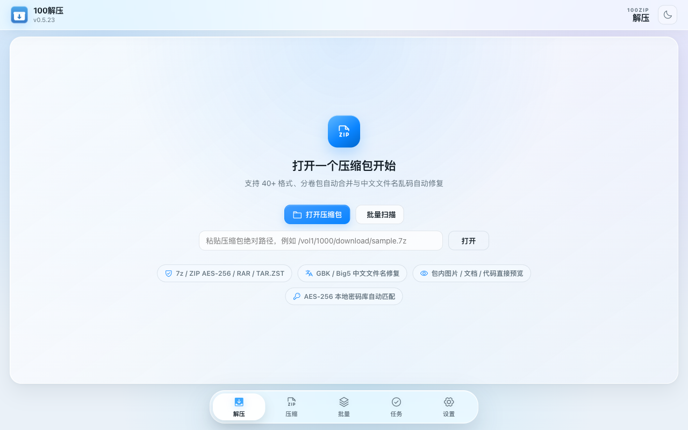
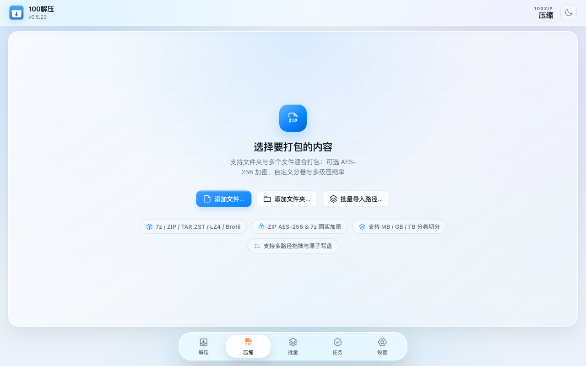
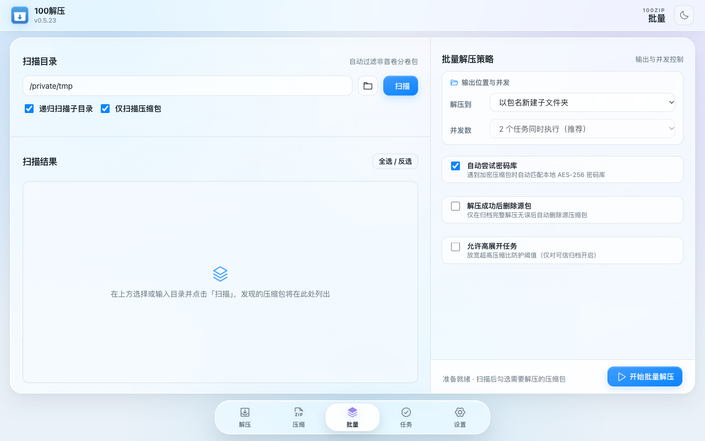
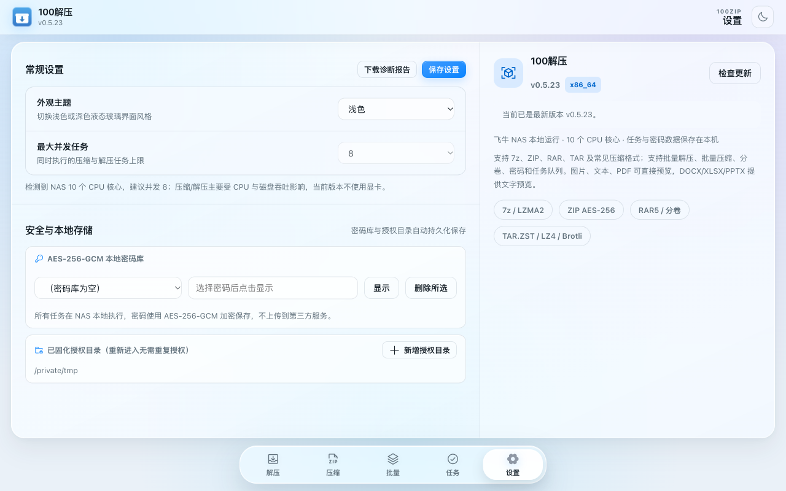
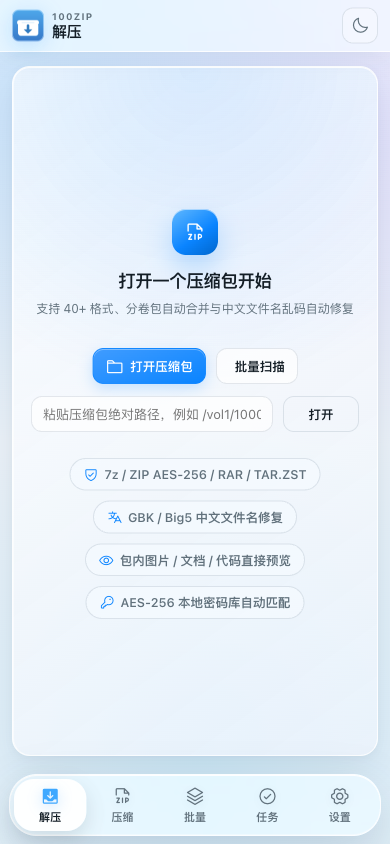
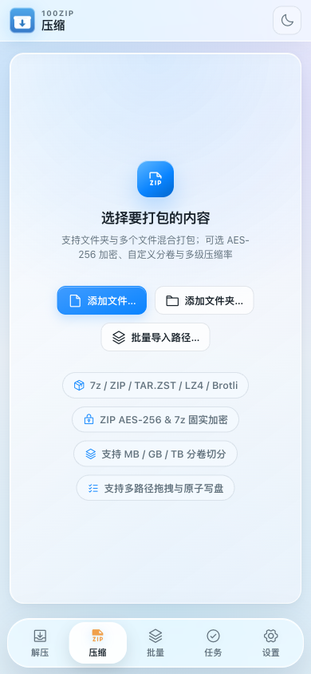
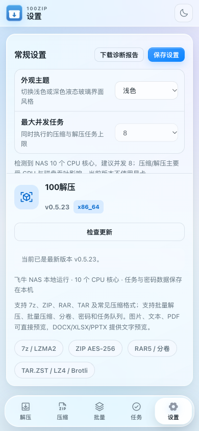

# 100zip

**面向飞牛 fnOS NAS 的原生压缩、解压与包内预览工具**

在 NAS 本机完成文件处理，支持批量任务、多卷压缩包、密码管理和桌面/移动端操作。

[下载最新版本](https://github.com/Alicace/100zip-releases/releases) · [查看更新日志](CHANGELOG.md) · [问题反馈](https://github.com/Alicace/100zip-releases/issues)

---

## 产品截图

以下说明图保持不变，来源于 100zip v0.5.23 的浅色界面。

### 网页端

<table>
<tr>
<td></td>
<td></td>
</tr>
<tr>
<td></td>
<td></td>
</tr>
</table>

### 手机端

  
  
  

桌面端与移动端共用同一套本地处理能力：先授权需要访问的目录，再在 NAS 本机完成压缩、解压和包内预览。

## v0.5.24 新版亮点

- **界面更聚焦**：精简界面文案，突出核心功能按钮，减少操作干扰。
- **代码保护加固**：前端采用混淆加密内嵌，Go 后端进行符号与字符串混淆。
- **稳定性与安全修复**：修复升级链接、搜索图标空白、手机端布局、批量全选、分卷特殊字符卡死及多项安全边界问题。
- **专有许可分发**：自 v0.5.23 起采用 100zip 专有许可，源码仓库保持私有，仅公开安装包和发行说明。

## 项目介绍

100zip 是一款为飞牛 fnOS NAS 打造的本地压缩与解压应用，目标是让归档、备份、下载包整理和媒体文件管理更简单。

它采用原生 FPK 安装，不依赖 Docker、Node.js 或 Python 运行环境。Go 服务负责任务调度、权限边界和文件处理，内置 7-Zip 引擎负责多格式压缩解压，网页界面适配桌面和手机浏览器。

所有文件都在 NAS 本机读写，不需要上传到第三方服务。应用通过 fnOS 授权目录控制访问范围，并提供任务记录、失败详情和诊断信息，方便定位密码、权限、缺卷、空间不足或格式不兼容等问题。

当前版本：**v0.5.24**，提供 fnOS x86_64 安装包。

## 核心功能

| 模块 | 能力 |
| --- | --- |
| 解压工作台 | 选择压缩包、切换加密多卷包、选择部分文件、指定输出目录、覆盖/跳过策略、自动创建子目录 |
| 压缩工作台 | 选择文件或文件夹、设置压缩文件名、ZIP/7z/TAR 等格式、压缩等级、分卷大小、密码和文件名加密 |
| 批量处理 | 多个压缩包批量解压并自动隔离目录；多个文件或文件夹批量生成相互独立的压缩文件 |
| 多卷支持 | 识别 `.7z.001`、`.zip.001`、`.z01`、`.part1.rar`、`.r00` 等命名方式，缺少卷时给出明确提示 |
| 包内浏览 | 展示目录树、文件名、大小、类型和路径；双击打开预览，支持放大、全屏和滚动 |
| 文件预览 | 图片、视频、音频、TXT/普通文本、PDF、DOC/DOCX、XLS/XLSX、PPT/PPTX 等常用格式 |
| 中文文件名 | 自动识别常见代码页，修复 GBK、Big5、日文等压缩包中的乱码文件名 |
| 密码库 | 保存常用密码、选择密码尝试、显示/隐藏明文、加密包切换后自动重新加载预览 |
| 任务中心 | 排队、并发数设置、实时速度、剩余时间、暂停/取消、重试、历史记录和失败详情 |
| 移动端 | 手机屏幕下的 Tab、任务卡片、预览区域、操作栏和弹窗自适应布局 |

## 支持格式

### 可解压

`7z` · `ZIP` · `RAR` · `TAR` · `GZ` · `BZ2` · `XZ` · `ZST` · `LZ4` · `BR (Brotli)` · `ISO` · `CAB` · `WIM` · `VHD/VHDX` · `ARJ` · `LZH` · `CPIO` 等。

### 可创建

`7z` · `ZIP (AES-256)` · `TAR` · `tar.gz` · `tar.bz2` · `tar.xz` · `tar.zst` · `tar.lz4` · `tar.br` · `zst` · `lz4` · `br`。

RAR 支持稳定解压，但不提供 RAR 创建。具体能力会受压缩格式本身、密码算法和文件系统限制影响。

## 快速上手

### 解压

1. 在“解压”页选择压缩包或多卷压缩包。
2. 如果是加密包，输入密码或从密码库选择。
3. 选择目标目录和覆盖策略。
4. 点击开始，任务会进入任务中心并显示进度。

### 压缩

1. 在“压缩”页添加文件或文件夹。
2. 在“格式与选项”中设置压缩文件名、格式、等级、分卷和密码。
3. 选择目标目录并开始任务。

### 预览

打开压缩包后选择文件即可预览。图片、PDF 和 Office 文档支持放大与滚动；视频和音频使用浏览器内置播放器播放。

## 安装

1. 从 [Releases](https://github.com/Alicace/100zip-releases/releases) 下载最新的 `.fpk` 安装包。
2. 进入 fnOS「应用中心 → 手动安装」，选择下载的 FPK 文件。
3. 安装完成后，从 fnOS 桌面打开 **100zip**。

当前公开下载渠道只提供 fnOS x86_64 安装包；版本清单可从 [`version.json`](version.json) 查看。

## 更新与发布

- [最新 Release](https://github.com/Alicace/100zip-releases/releases)
- [完整更新日志](CHANGELOG.md)
- [版本清单](version.json)
- [SHA-256 校验和](SHA256SUMS)

应用内更新检查会读取公开的 `version.json` 和 GitHub Releases 信息。下载前可以使用 `SHA256SUMS` 或 Release 页面显示的摘要校验安装包完整性。

## 隐私与安全

- 文件处理在 NAS 本机完成，不上传文件内容。
- 只访问用户在 fnOS 中明确授权的目录。
- 密码库与任务数据按用户隔离；密码不会写入诊断日志。
- 诊断报告可能包含文件名、路径和任务参数，分享前请先检查内容。

## 问题反馈

请在 [Issues](https://github.com/Alicace/100zip-releases/issues) 中提供：

- fnOS 版本和 NAS CPU 架构
- 100zip 版本
- 压缩格式以及是否加密/分卷
- 复现步骤和任务错误信息

不要在公开 Issue 中提交密码、隐私文件名或完整 NAS 路径。

## 许可证

自 **v0.5.23** 起，100zip 自研代码采用 [100zip Proprietary License](LICENSE)，未经版权持有人书面许可不得复制、修改、再发布、销售或制作衍生作品。v0.5.22 及更早版本以各版本随附的 MIT License 为准。随安装包分发的 7-Zip 引擎、Phosphor Icons 等第三方组件继续遵循各自许可证。

本仓库是公开下载与发行说明渠道，不包含 100zip 产品源码；源码仓库为私有仓库。
